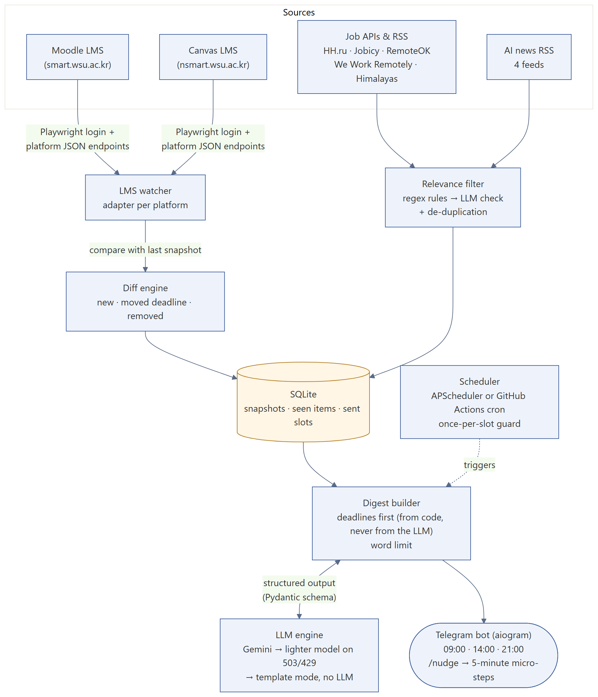
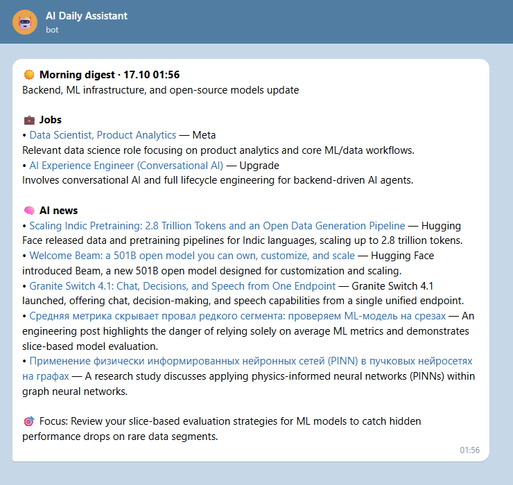

# AI Daily Assistant & LMS Watcher

**Stack:** Python 3.11 (asyncio), Playwright, aiogram (Telegram), APScheduler / GitHub Actions cron, Gemini / OpenAI with Pydantic structured output, SQLite
**Code:** https://github.com/askarbekkk/ai-daily-assistant

## Problem
My university uses two learning portals (Moodle and Canvas). Deadlines move, new assignments appear, and I also track AI jobs and news. Checking everything by hand every day wastes time and things get missed.

## What I built
A personal assistant that logs into both portals, watches for new assignments and moved deadlines, collects relevant jobs and AI news, and sends one short Telegram digest three times a day (09:00 · 14:00 · 21:00). Deadlines always come first.

## How it works
1. **LMS watcher.** Playwright logs in headlessly; instead of fragile HTML scraping it calls the platforms' own JSON endpoints (Moodle AJAX service, Canvas Planner API) inside the logged-in session. One adapter per platform.
2. **Diff engine.** The current state is compared with the last SQLite snapshot; only *new*, *moved* and *removed* tasks trigger a message.
3. **Relevance filter.** Jobs from HH.ru, Jobicy, RemoteOK, We Work Remotely and Himalayas pass a regex filter and then an LLM check (ML / AI / data / backend only; senior and sales roles dropped). News from 4 feeds is de-duplicated.
4. **Digest builder.** Deadlines are rendered by code, never by the LLM, so dates cannot be hallucinated. The LLM writes the summary through a Pydantic schema (structured output) under a word limit.
5. **Resilience.** On 503/429 it falls back to a lighter Gemini model; if all models fail it sends a template digest with no LLM. A once-per-slot guard prevents duplicate messages when both cron triggers fire.
6. **`/nudge <task>`** breaks a daunting task into 5-minute micro-steps.

## Demo
Real dry-run output (nothing sent), rendered as the Telegram message. During the run Gemini Flash returned 503 and the assistant switched to Flash-Lite automatically.

From the same run: 106 job postings fetched → 7 kept after filtering → 2 chosen for the digest; 27 news items from 4 feeds. Digest language is a setting (English or Russian).

## Quality
17 automated tests pass: deadline diffing, time-zone bucketing, digest trimming that keeps deadlines, job and clickbait filters, Moodle/Canvas/job-API parsers, storage.
