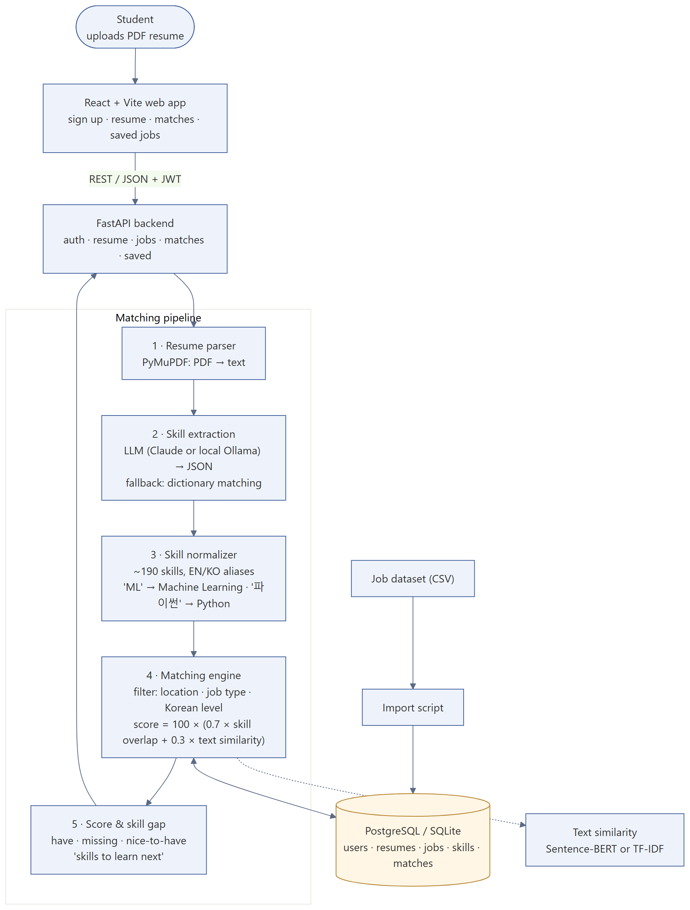
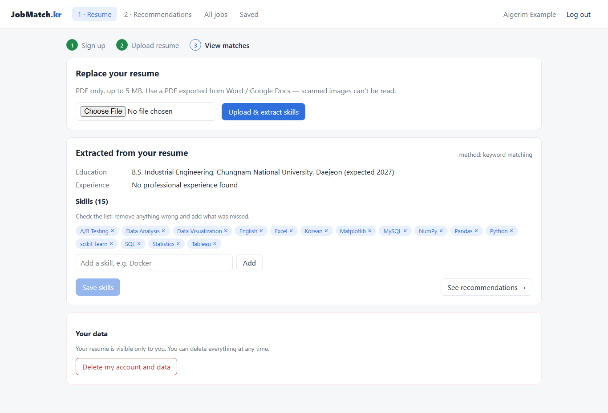
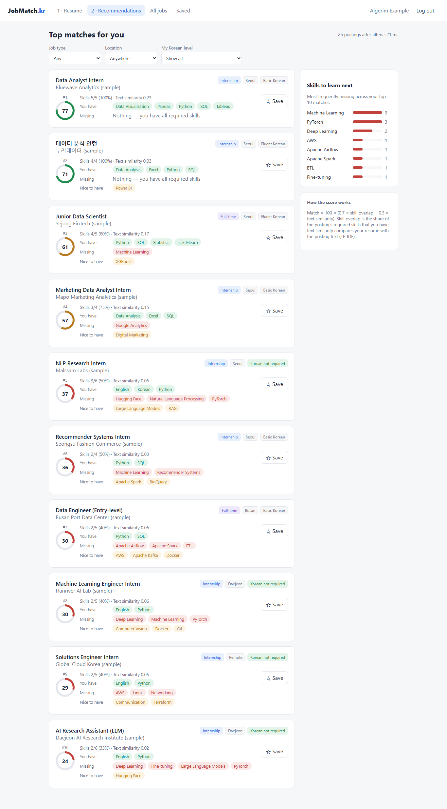

# AI Job & Internship Assistant (JobMatch.kr)

**Stack:** React + Vite, FastAPI, SQLAlchemy (PostgreSQL / SQLite), PyMuPDF, Claude or local Ollama LLM, TF-IDF / Sentence-BERT, pytest, Docker Compose
**Code:** https://github.com/askarbekkk/ai-job-assistant

## Problem
International students in Korea scroll through hundreds of postings and cannot tell quickly which ones fit their skills, location and Korean level, or what they should learn next.

## What I built
A web app: upload a PDF resume and get the top 10 matching internships and entry-level jobs in Korea, each with a 0–100 score, the skills you already have, the skills you are missing, and a "skills to learn next" summary across all matches.

## How it works
1. **Resume parser.** PyMuPDF turns the PDF into text.
2. **Skill extraction.** An LLM (Claude, or a free local model via Ollama) returns skills as JSON. Without an LLM it falls back to dictionary matching, so the app works with no API key.
3. **Normalization.** About 190 skills with English and Korean aliases: "ML" → Machine Learning, "파이썬" → Python.
4. **Matching.** Postings are filtered by location, job type and required Korean level, then scored:
   `score = 100 × (0.7 × skill overlap + 0.3 × text similarity)` (TF-IDF, or Sentence-BERT when installed).
5. **Skill gap.** For every match: have / missing / nice-to-have.

Also: JWT authentication, saved jobs, editable skill list, and "delete my account and data" that removes the resume file too.

## Demo (sample postings, fictional candidate)
| Resume → extracted skills | Top matches with skill gap |
|---|---|
|  |  |

More: [all jobs](01_jobs.png) · [job detail](04_job_detail.png)

## Evaluation
- Skill extraction (dictionary mode) on hand-labelled resumes: precision 0.95, recall 1.00, F1 0.976.
- Ranking Precision@5: 0.80, equal to the keyword-only baseline on the current labels. The eval set has only 3 resumes, so the next step is 20 resumes × 20 labelled postings before tuning the 0.7/0.3 weights.
- 23 automated tests (API + matching) pass.

## Limitations
- Job postings in the demo are a labelled sample set, not live scraping.
- Dictionary extraction misses experience sections (it found the education but not the internship in the demo resume); the LLM extraction mode is meant to cover this case.
