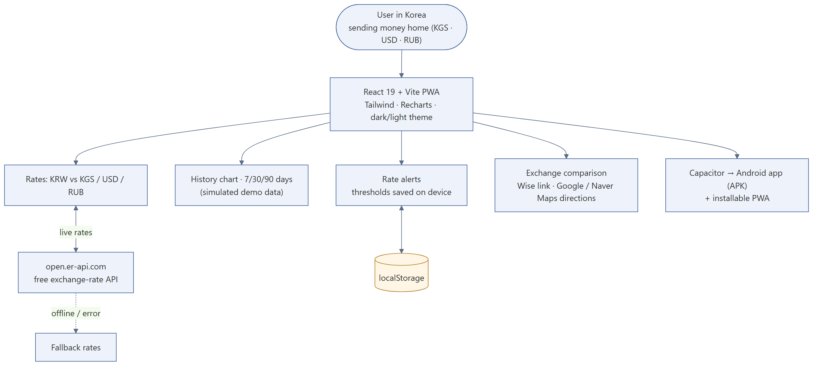
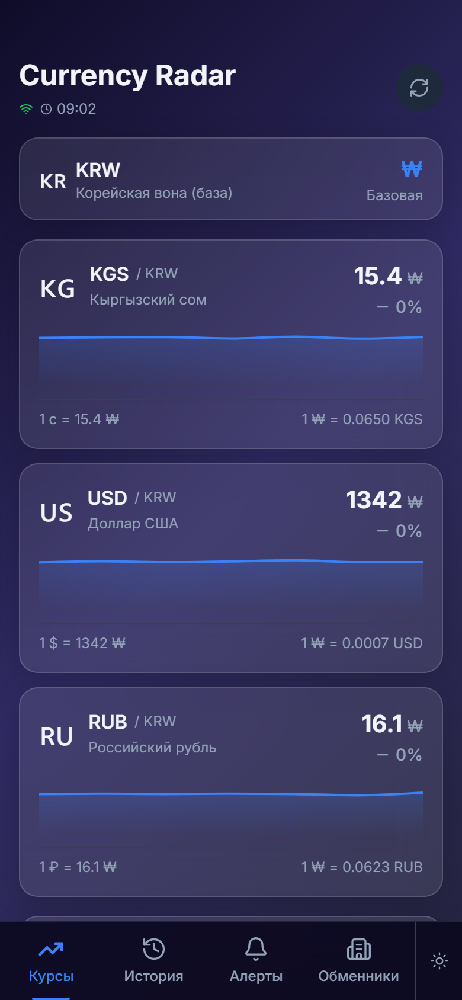
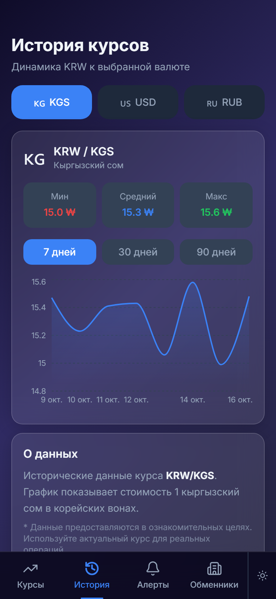

# Currency Radar — KRW exchange rates for Central Asians in Korea

**Stack:** React 19, Vite, Tailwind CSS, Recharts, PWA, Capacitor (Android) · **Status:** personal app

## Problem
People from Kyrgyzstan, Kazakhstan and Russia working in Korea send money home and need a quick view of KRW against KGS, USD and RUB, plus where to exchange.

## What I built
A mobile-first app, installable as a PWA and packaged as an Android app with Capacitor:
- live KRW rates against KGS, USD, RUB (open.er-api.com, with offline fallback values),
- rate history chart with 7 / 30 / 90-day ranges and min / average / max,
- rate alerts saved on the device,
- exchange comparison with links to Wise and directions in Google Maps / Naver Map,
- dark and light theme.

## Screens
| Rates | History | Alerts | Exchangers |
|---|---|---|---|
|  |  |  |  |

**Honest note:** the free API gives only current rates, so the history chart currently uses simulated data around the live rate. A history-capable API is the next step.
