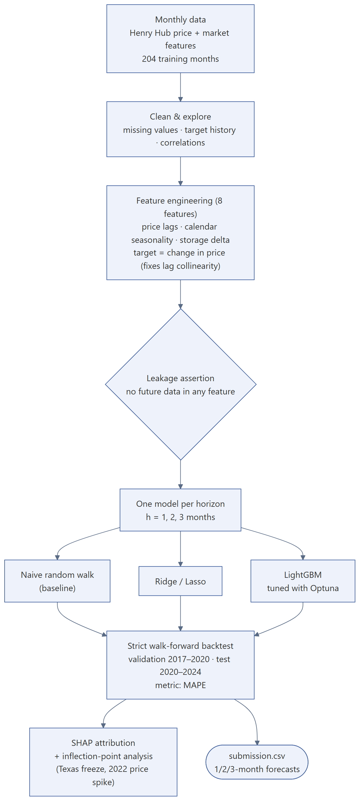
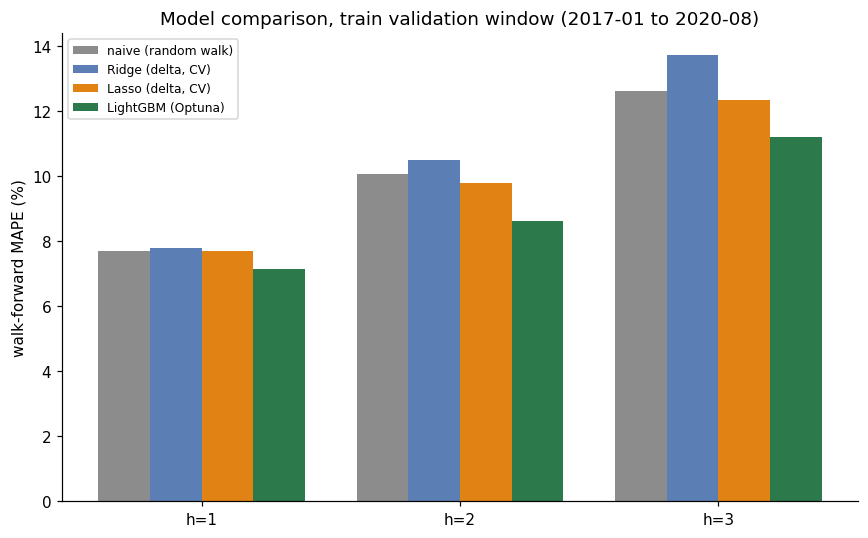
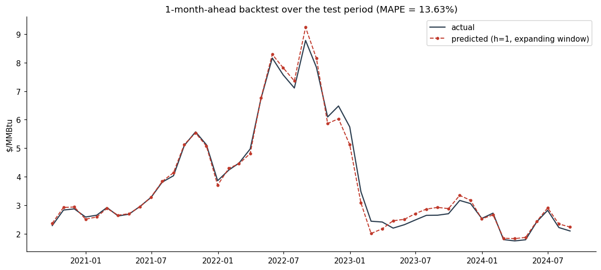
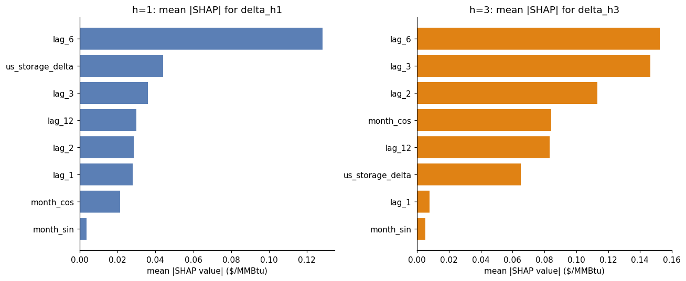

# Henry Hub Natural Gas Price Forecasting

**Context:** take-home coding test for an AI company · **Stack:** Python, pandas, scikit-learn, LightGBM, Optuna, SHAP, Matplotlib
**Code:** https://github.com/askarbekkk/gas-price-forecasting

## Problem
Forecast the monthly Henry Hub natural-gas price 1, 2 and 3 months ahead, with only about 200 months of training history and a test period that includes the 2021 Texas freeze and the 2022 price spike.

## Approach

1. **Strict walk-forward backtest.** Every forecast uses only data available at that month; a leakage assertion checks that no feature looks into the future.
2. **Honest baseline first.** A naive random walk (next month = this month) is hard to beat: 7.7% / 10.1% / 12.6% MAPE at h = 1/2/3.
3. **Features (8).** Price lags, calendar seasonality and a gas-storage delta.
4. **Fix that mattered.** Ridge and Lasso on raw price levels lost to the baseline because the lags are almost collinear. Reframing every model to predict the *change* in price fixed it.
5. **LightGBM per horizon,** tuned with Optuna on the validation window.
6. **Explain the misses.** SHAP attribution and inflection-point snapshots show what the model relied on at the turning points.

## Results
| Validation 2017–2020 | Test backtest 2020–2024 |
|---|---|
|  |  |

LightGBM beat the naive baseline at every horizon on validation (7.15 / 8.63 / 11.20% MAPE) and also on the unseen 2020–2024 test (13.6 / 20.6 / 27.0% vs 13.7 / 22.9 / 29.2%).

**Honest limitation:** the model extrapolates recent momentum plus storage changes. That works in normal months and is blind at sudden shocks (a freeze, an invasion), exactly when turning points matter most. More frequent data and event features would be the next step.
