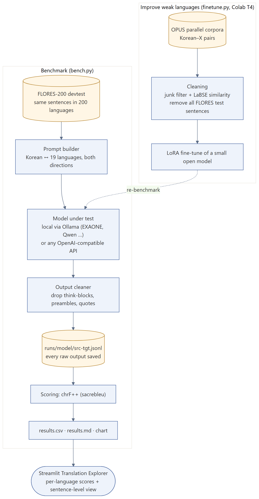
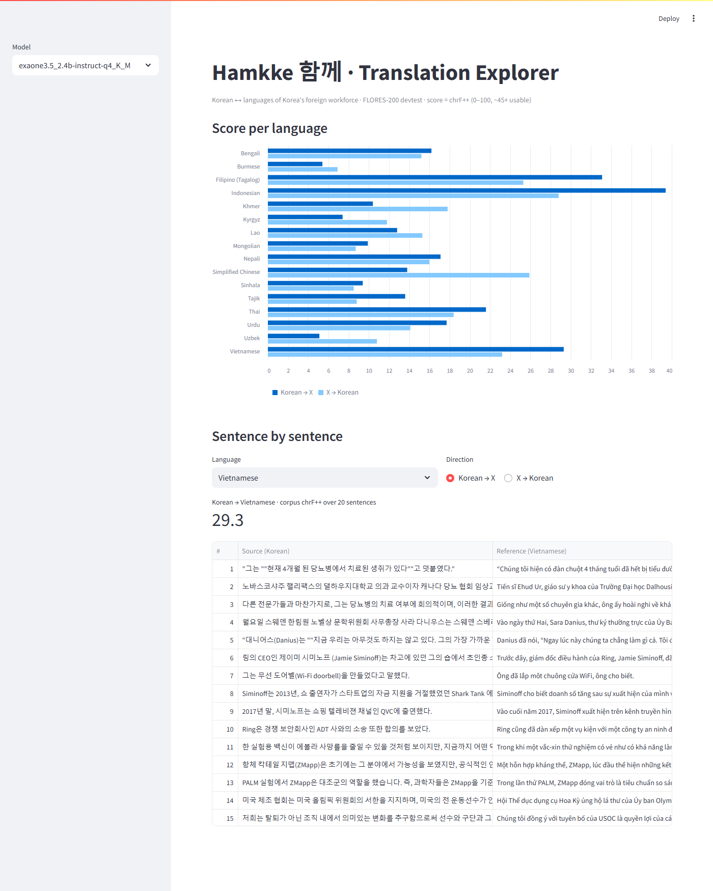

# Hamkke (함께) — can Korea's AI models translate for everyone who works in Korea?

**Status:** work in progress · **Stack:** Python, Ollama, OpenAI-compatible APIs, sacrebleu (chrF++), FLORES-200, LoRA (PEFT) on Colab, Streamlit
**Code:** https://github.com/askarbekkk/hamkke-mt

## Problem
Hundreds of thousands of people from Vietnam, Nepal, Cambodia, Uzbekistan, Myanmar and other countries work in Korea. Korean AI models (EXAONE, HyperCLOVA X, Kanana, Solar) are mostly evaluated on Korean, English, Japanese and Chinese. Their quality on the languages of Korea's foreign workforce is rarely reported.

## What I built

1. **Benchmark (`bench.py`).** Professional reference translations from FLORES-200; every model is tested in both directions (Korean → X and X → Korean) for 19 languages and scored with chrF++. Every raw output is saved, so results can be inspected and re-scored.
2. **Output cleaner.** Chat models add "Here is the translation:", quotes or `<think>` blocks; the cleaner removes them so the score measures the translation, not the chatter.
3. **Improvement track (`finetune.py`).** Korean–X pairs from OPUS, filtered for junk and mismatches with LaBSE similarity, with all test sentences removed, then a LoRA adapter on a small open model (free Colab GPU).
4. **Translation Explorer (Streamlit).** Scores per language plus a sentence-by-sentence view of model output vs. reference.

## First results (EXAONE 3.5 2.4B, local)

- Average chrF++ ≈ 16 in both directions (about 45+ is usable).
- Best: Indonesian (39), Filipino (33), Vietnamese (29). Nearly unusable: Uzbek and Burmese (5).
- Example failure: *"mice that were cured of diabetes"* became *"a 4-month-old loach fish"* in Vietnamese.

## Next
Larger Korean models and strong baselines, a LoRA model for Khmer, Nepali and Burmese, and a small test set of real workplace-safety sentences.
