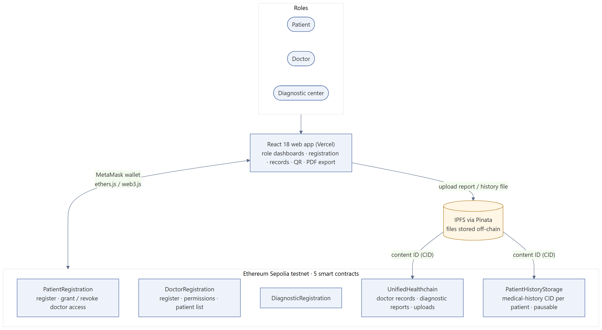
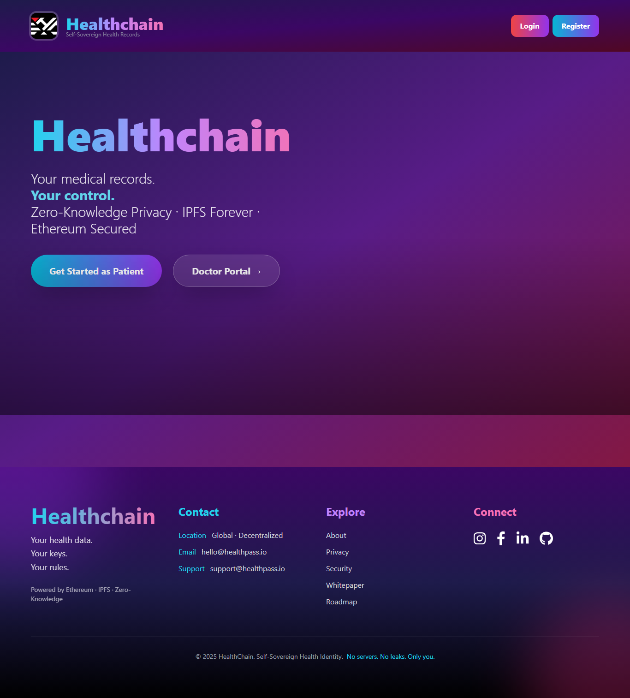
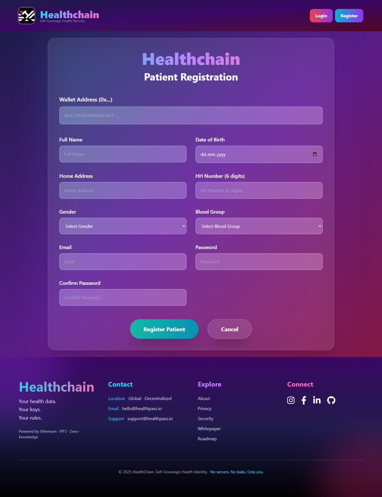

# HealthChain — patient-controlled medical records on Ethereum

**Stack:** React 18, ethers.js / web3.js, MetaMask, 5 smart contracts on Ethereum Sepolia, IPFS (Pinata), Tailwind / MUI · deployed on Vercel
**Code:** https://github.com/askarbekkk/HealthchainDapp · **Live:** https://healthchain-dapp-one.vercel.app

## Problem
Medical records are scattered across hospitals and labs, and patients cannot see or control who reads them.

## What I built
A decentralized app with three roles: patient, doctor and diagnostic center. Patients grant and revoke doctors' access on-chain; doctors and labs add records; files are stored on IPFS and only their content IDs go on the blockchain.

- **Contracts:** PatientRegistration, DoctorRegistration, DiagnosticRegistration, UnifiedHealthchain (records, reports, uploads), PatientHistoryStorage (pausable, history CID per patient).
- **Frontend:** role dashboards, record creation, QR codes and PDF export, MetaMask wallet login.

## Live site
| Landing | Registration |
|---|---|
|  |  |
