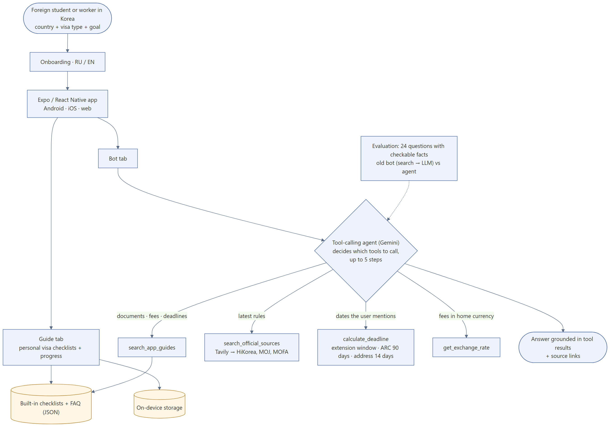
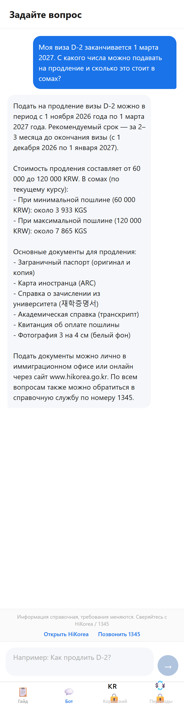
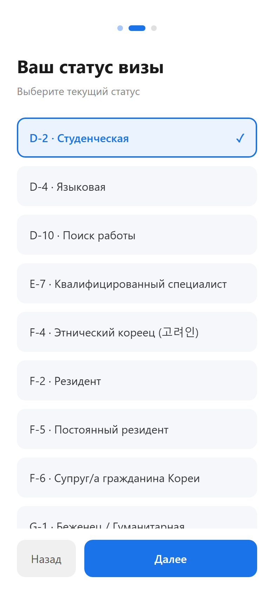
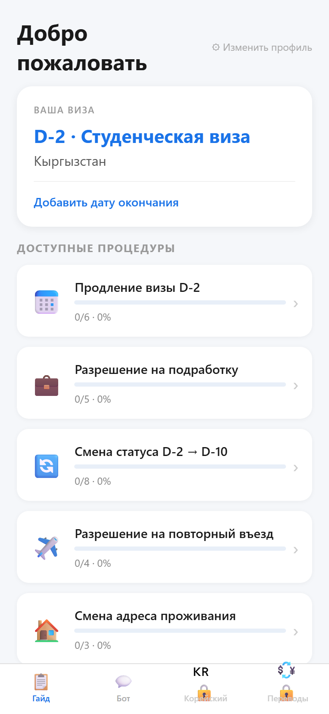
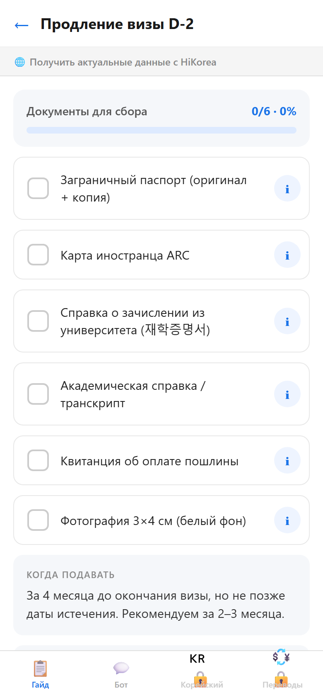
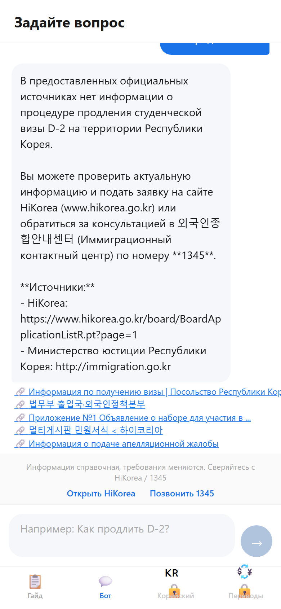

# Korea Visa Guide — visa and immigration guide for foreigners in Korea

**Stack:** Expo / React Native (TypeScript), AsyncStorage, i18n (RU / EN), Tavily search, Gemini / DeepSeek / Claude (switchable provider)
**Status:** MVP

## Problem
Students and workers from Central Asia and Russia in Korea struggle with visa procedures: which documents for a D-2 extension, when to apply, how much it costs. Official information is on HiKorea, mostly in Korean, and changes over time.

## What I built
A mobile app (Android, iOS and web from one codebase):
- **Onboarding:** country, current visa (D-2, D-4, D-10, E-7, F-2, F-4, F-5, F-6, G-1, H-2) and goal.
- **Guide:** personal checklists for the user's visa (extension, part-time work permit, status change D-2 → D-10, re-entry permit, address change, ARC). Progress is saved on the device; each item has an explanation, deadline and fee.
- **Live refresh:** Korean-language search queries pull the current requirements from HiKorea and an LLM extracts documents and fees.
- **Bot:** questions answered from official sources found by web search, always with source links and a fallback to HiKorea / the 1345 hotline.

## Tool-calling agent
The first bot only searched the web and answered "not in the sources" even when the app's own checklist had the answer. I rebuilt it as a Gemini function-calling agent with four tools: `search_app_guides`, `search_official_sources` (HiKorea, MOJ, MOFA), `calculate_deadline` and `get_exchange_rate`. Dates are computed by code, never by the model.

**Evaluation:** 24 questions with checkable facts (RU/EN), same model for both systems. Previous bot 8–13%, agent 96–100% over three runs; the expected tool was chosen in 92–96% of questions. In the final run the only miss was a free-tier rate-limit error.

## Demo (web build)
| Onboarding | Dashboard | D-2 extension checklist | Bot |
|---|---|---|---|
|  |  |  |  |

## What I fixed along the way
- The Gemini model name was pinned to `gemini-2.0-flash`, which Google retired (404). It now uses the `gemini-flash-latest` alias.
- Added a fallback to `gemini-flash-lite-latest` when the main model is overloaded (429/503).
- Raised the output-token limit after long answers came back empty, and switched answers to plain text because the chat showed raw Markdown.

## Next steps
- API keys are bundled into the client (`EXPO_PUBLIC_*`). Before a public release the LLM calls must go through a small server proxy.
