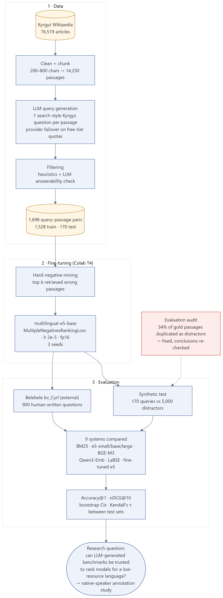
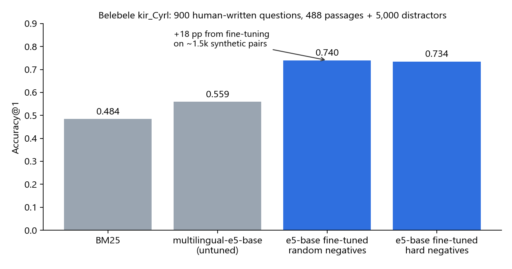
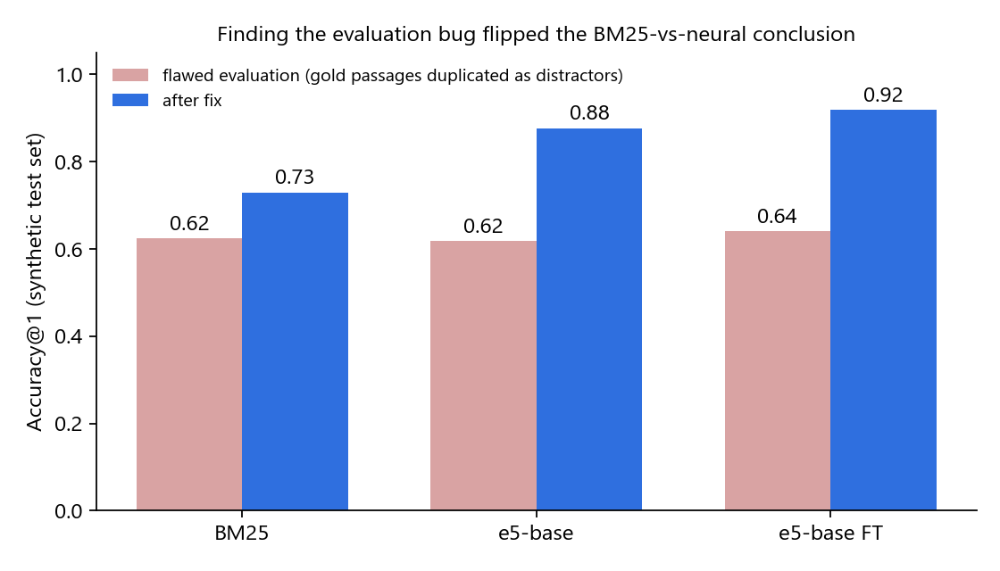
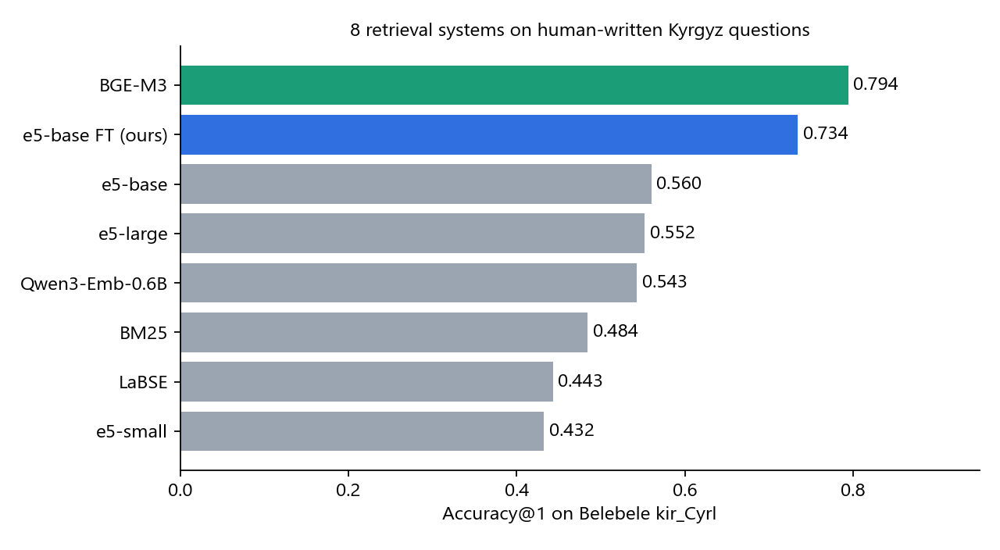
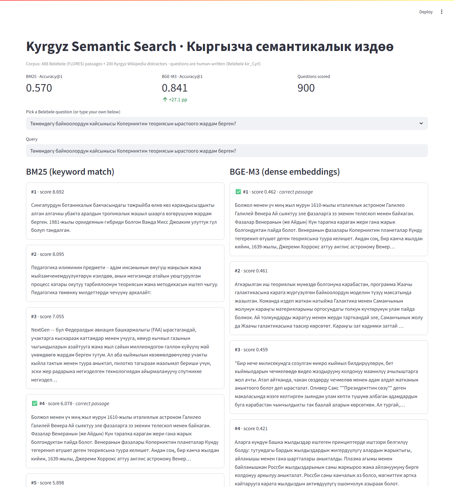

# Kyrgyz Semantic Retrieval

**Type:** research with a university professor · **Stack:** Python, PyTorch, sentence-transformers, Hugging Face, rank_bm25, Ollama (BGE-M3), Streamlit
**Code:** https://github.com/askarbekkk/kyrgyz-embeddings

## Problem
Kyrgyz (~5 million speakers) has almost no data for training search models. Questions: how well do multilingual embedding models retrieve Kyrgyz text, does fine-tuning on LLM-generated pairs help, and can an LLM-generated test set be trusted to rank models the way human questions do?

## What I did
1. **Data.** Kyrgyz Wikipedia (76,519 articles) → 14,250 passages of 200–800 characters → an LLM wrote one search-style question per passage → heuristic and LLM filters → 1,698 query–passage pairs (1,528 train / 170 test).
2. **Fine-tuning.** multilingual-e5-base with MultipleNegativesRankingLoss and mined hard negatives, 3 seeds, Colab T4.
3. **Evaluation.** Synthetic test (170 queries vs 5,000 distractors) and the external Belebele kir_Cyrl benchmark (900 human-written questions, 488 passages + 5,000 distractors); 9 systems; Accuracy@1, nDCG@10, bootstrap confidence intervals, Kendall's τ between test sets.
4. **Audit.** I found that 34% of gold passages also appeared as distractors under a second ID. The bug understated every model by up to 26 points and reversed the BM25-vs-neural conclusion; all results were re-run after the fix.

## Results

- Fine-tuning on ~1.5k synthetic pairs: Accuracy@1 0.56 → 0.74 on human-written Belebele questions (+18 pp).
- Zero-shot BGE-M3 is the strongest model (0.794), so fine-tuning BGE-M3 is the next step.

| Evaluation bug | Model comparison |
|---|---|
|  |  |

## Demo
BM25 vs BGE-M3 on a laptop (488 Belebele passages + 200 Wikipedia distractors, all 900 questions scored): **0.570 vs 0.841 Accuracy@1**. In the example, BGE-M3 ranks the correct passage first and BM25 ranks it fourth.

## Now
A study on whether LLM-generated benchmarks rank models like human-written ones: the same held-out passages with three query sources (raw LLM, annotator-validated, human-written), two native-speaker annotators and inter-annotator agreement.
