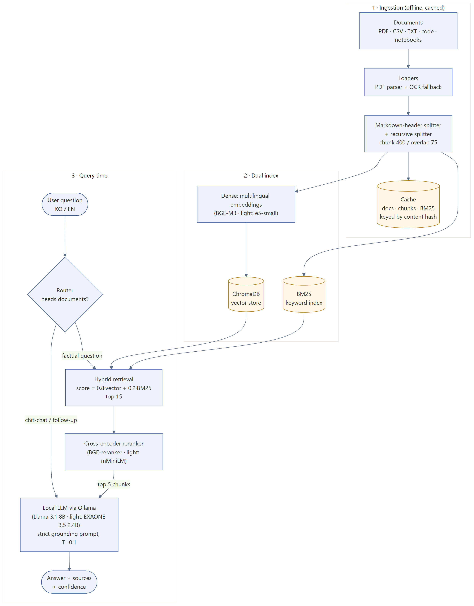
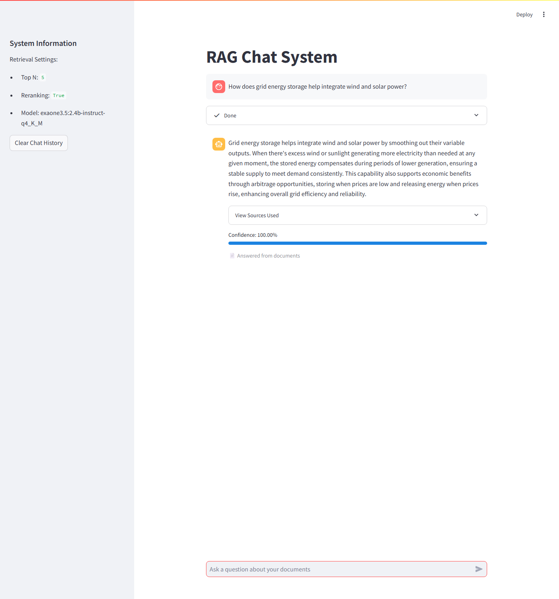
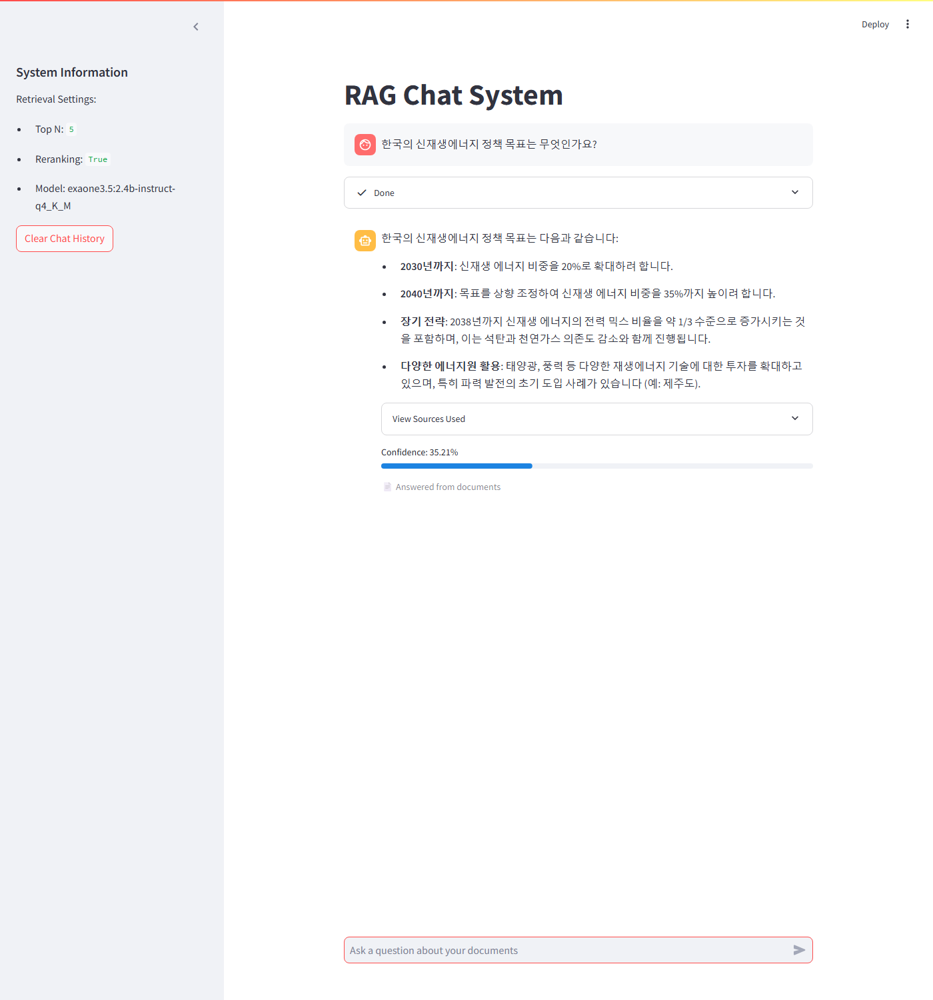

# Secure Offline RAG — document Q&A that never leaves the network

**Client:** KREPS (Korean renewable-energy company) · **Stack:** Python, LangChain, Ollama, ChromaDB, BM25, sentence-transformers, Streamlit
**Code:** https://github.com/askarbekkk/offline_rag

## Problem
An energy company wanted an assistant that answers questions about its internal technical documents (Korean and English PDFs, spreadsheets, text). Cloud LLM APIs were not an option: the documents could not leave the company network.

## What I built
A retrieval-augmented generation (RAG) system that runs entirely on local hardware: no external API calls, no data leaving the machine. It has a chat UI that shows the sources behind every answer and a confidence score.

## How it works
1. **Ingestion.** Loaders for PDF (with OCR fallback for scanned pages), CSV, TXT, Office files, code and notebooks. Text is split by Markdown headers first, then recursively (400 characters, 75 overlap), so chunks follow the document structure.
2. **Two indexes.** Dense multilingual embeddings in ChromaDB (BGE-M3 on a GPU server; e5-small on a laptop) plus a BM25 keyword index. Documents, chunks and the BM25 index are cached by content hash, so restarts are fast.
3. **Router.** A rule-based check skips retrieval for greetings and follow-ups, which saves an LLM call on an 8 GB machine.
4. **Hybrid retrieval.** Score = 0.8 × vector + 0.2 × BM25, top 15. Keywords catch exact part numbers and codes, embeddings catch paraphrases and cross-language matches.
5. **Reranking.** A multilingual cross-encoder re-scores the 15 candidates; the best 5 go to the LLM.
6. **Generation.** A local LLM through Ollama (Llama 3.1 8B on the server, EXAONE 3.5 2.4B on a laptop) answers with a strict grounding prompt at temperature 0.1.

Two hardware profiles are configured in YAML, so the same code runs on a CUDA server or a CPU-only laptop.

## Demo
Public demo corpus: 8 Wikipedia articles on solar, wind, energy storage and Korean renewable-energy policy, in English and Korean (the client's documents are confidential). Everything runs on a laptop CPU (Ryzen 5, 8 GB RAM).

| English question | Korean question |
|---|---|
|  |  |

The Korean question about Korea's renewable-energy targets is answered in Korean with the correct figures (20% by 2030, 35% by 2040, about one third by 2038). The supporting passages came from both the English and the Korean articles: cross-lingual retrieval.

Measured on the laptop: indexing the 435 chunks took about 1 minute; retrieval plus reranking of one question took about 6 seconds before generation started.

## What I fixed while preparing this demo
Text files were opened with the Windows default encoding (cp1251), so any Korean `.txt` document crashed ingestion. One line in the shared loader now reads text as UTF-8.

## Limitations and next steps
- The router is keyword-based; a small classifier would handle more phrasings.
- No automatic evaluation set yet; next: a small labelled Q&A set to measure retrieval recall and answer faithfulness.
