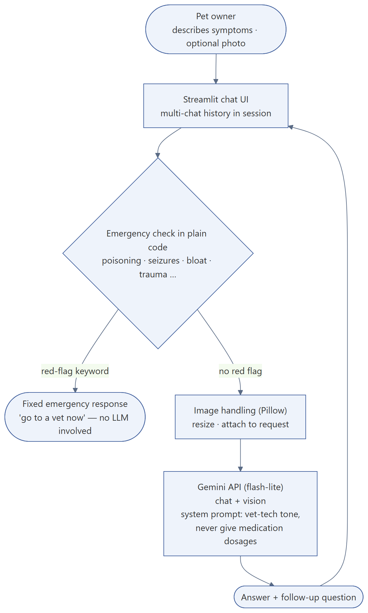
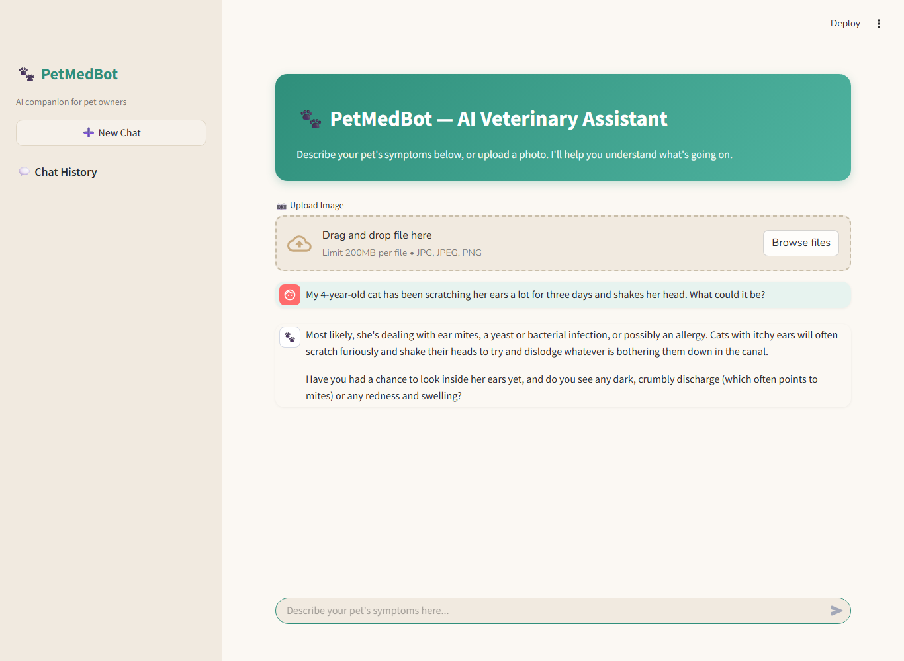
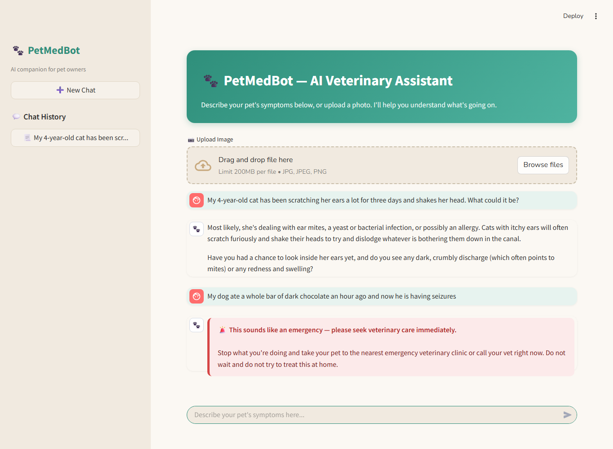

# PetMedBot — AI veterinary assistant with code-level safety rules

**Stack:** Python, Streamlit, Gemini API (chat + vision), Pillow · deployed on Streamlit Community Cloud
**Code:** https://github.com/askarbekkk/petmedbot__LLM · **Live:** https://petmedbot.streamlit.app (may need a wake-up click)

## Problem
Pet owners search symptoms at night and either panic or ignore real emergencies. A chatbot can help with triage, but an LLM must never be the thing that decides whether a poisoned dog goes to the vet.

## What I built
A conversational assistant: describe symptoms or upload a photo, get calm, vet-tech-style guidance and a follow-up question. Multi-chat history in the sidebar.

**Key design decision:** the emergency check is plain code that runs *before* the model is called. Poisoning, seizures, bloat, trauma and similar red flags return a fixed "go to a vet now" response, so safety never depends on the model getting it right. The system prompt also forbids medication dosages.

## Demo
| Normal question | Emergency (no LLM call) |
|---|---|
|  |  |
