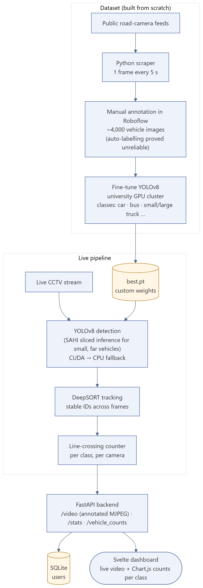
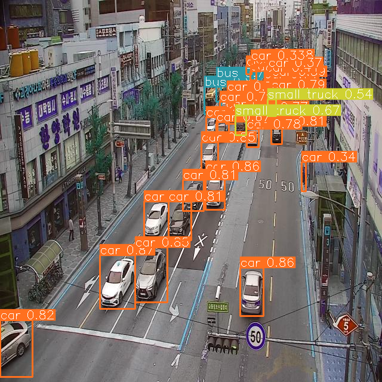
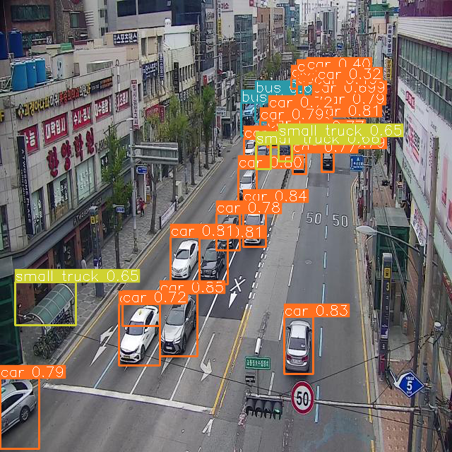

# Smart Traffic Monitoring — vehicle detection, tracking and counting on live CCTV

**Type:** university team project for a CCTV-monitoring company · **Stack:** Python, PyTorch, YOLOv8, SAHI, DeepSORT, OpenCV, Roboflow, FastAPI, Svelte, Chart.js

## Problem
Count vehicles by type on live city-camera streams. Off-the-shelf detectors trained on generic datasets missed small, distant and partially hidden vehicles on Korean streets, and automatic labelling produced too many errors to train on.

## My part
- Wrote a Python scraper that saved a frame from public road-camera feeds every 5 seconds to build the dataset.
- Hand-annotated about 4,000 vehicle images in Roboflow after automatic labelling proved unreliable.
- Fine-tuned YOLOv8 on the university GPU cluster.
- Built the detection + tracking pipeline (YOLOv8 + DeepSORT) with automatic CUDA → CPU fallback.

The team also built a Svelte dashboard and a FastAPI video service around the pipeline.

## How it works
1. **Detection:** the fine-tuned YOLOv8 model; SAHI sliced inference (512 px tiles, 20% overlap) recovers small vehicles far from the camera.
2. **Tracking:** DeepSORT keeps a stable ID per vehicle across frames.
3. **Counting:** a vehicle is counted once when its track crosses a virtual line, per class and per camera.
4. **Serving:** FastAPI streams the annotated video and serves counts; the dashboard shows live video and per-class charts.

## Results
Output of our trained model on a city-camera frame (classes: car, bus, small truck):

| Standard inference | SAHI sliced inference |
|---|---|
|  |  |
